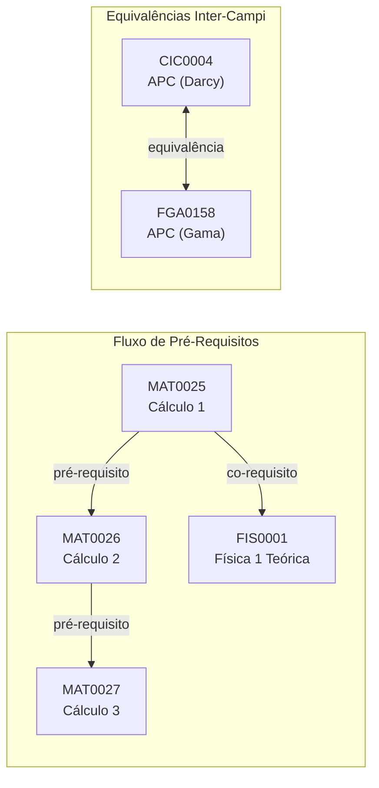
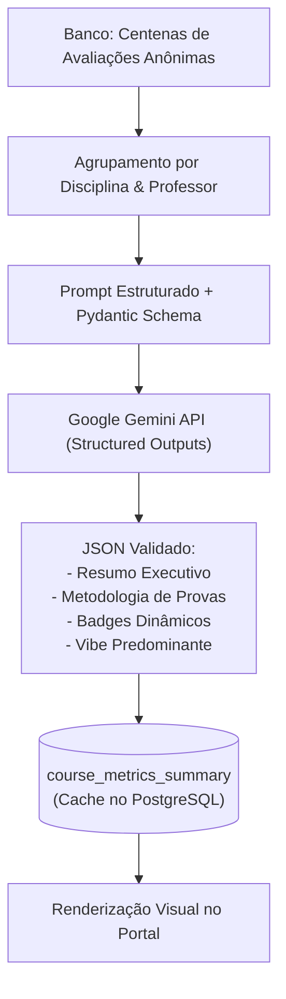

# Catálogo, Ementas & Análise UnBook (`services/catalog`)

O **`services/catalog`** é o serviço responsável pela modelagem do conhecimento curricular e inteligência pedagógica do **UnBook 2.0**, mantido pela **Squad Catalog (`@unbook-org/squad-catalog`)**.

---

## Visão Geral & Responsabilidades

O serviço centraliza toda a lógica de cursos, disciplinas, ementas e dependências acadêmicas da UnB, além de orquestrar a geração da **"Análise UnBook"** via inteligência artificial:

1. **Guia Curricular & Ementas:** Exposição detalhada dos programas de ensino, cargas horárias, créditos e departamentos de cada matéria da UnB.
2. **Grafos de Dependência Curricular:** Navegação pelas árvores de pré-requisitos, co-requisitos e equivalências registradas na tabela canônica `TB_RELACAO_MATERIA`.
3. **Listas Personalizadas do Estudante (`/catalog/mylist`):** Permite ao aluno marcar matérias cursadas, pendentes ou de interesse para o próximo semestre, alimentando recomendações personalizadas.
4. **Síntese Inteligente (Análise UnBook):** Geração de resumos executivos objetivos a partir de múltiplos relatos e avaliações anônimas utilizando a **Google Gemini API**.

---

## Stack Tecnológica

| Camada | Tecnologia | Justificativa Técnica |
| :--- | :--- | :--- |
| **Framework API** | **Django 5 + Django Ninja (Python 3.12)** | Rotas assíncronas de alta performance, validação nativa via Pydantic v2 e documentação Swagger automática. |
| **Banco & ORM** | **PostgreSQL 16 + Django ORM** | Modelagem declarativa do grafo curricular (`TB_RELACAO_MATERIA`), migrações robustas e suporte a `pgvector`. |
| **Moderação & Gestão**| **Django Admin** | Interface pronta para auditoria e moderação de avaliações anônimas e retificações curriculares. |
| **Inteligência Artificial** | **Google Gemini API (via Instructor & LiteLLM)** | Sumarização avançada de avaliações com garantia estrita de formato JSON (*Structured Outputs*). |

---

## Grafo de Dependências (`TB_RELACAO_MATERIA`)

O `services/catalog` processa as relações curriculares da UnB modeladas como um grafo direcionado:



### Tipos de Relações Curriculares:
- **`pre_requisito`:** Disciplinas cujo trancamento ou reprovação impede a matrícula na matéria-alvo.
- **`co_requisito`:** Disciplinas que devem ser cursadas obrigatoriamente no mesmo semestre letivo.
- **`equivalencia`:** Disciplinas que cumprem a mesma exigência curricular entre departamentos ou campi distintos (ex: Darcy vs FGA).

---

## Análise UnBook via Google Gemini API

Para poupar os estudantes da leitura de dezenas de comentários manuais repetitivos, o `services/catalog` executa um pipeline de sumarização utilizando o modelo **Google Gemini** com biblioteca **Instructor**:



### Contrato de Saída do Gemini (Schema Pydantic):
```python
from pydantic import BaseModel, Field

class AnaliseUnBookSummary(BaseModel):
    resumo_executivo: str = Field(description="Síntese neutra e objetiva de até 3 frases sobre a condução da disciplina.")
    estilo_didatico: str = Field(description="Principais características da didática do professor.")
    metodologia_provas: str = Field(description="Como as avaliações são cobradas (teóricas, práticas, coerência).")
    pontos_fortes: list[str] = Field(description="Até 3 aspectos positivos destacados pelos alunos.")
    pontos_atencao: list[str] = Field(description="Até 3 pontos de atenção pedagógicos.")
    badges: list[str] = Field(description="Lista de badges atribuídos, ex: 'PADGE: SONO', 'PADGE: PROVA JUSTA'.")
```

---

## Lista Personalizada do Aluno (`/catalog/mylist`)

O endpoint `/catalog/mylist` armazena o planejamento pessoal de longo prazo do estudante:
- **Disciplinas Cursadas:** Matérias já concluídas, permitindo que a API valide se o estudante cumpriu todos os pré-requisitos para turmas futuras.
- **Disciplinas de Interesse:** Matérias salvas para simulação rápida no **UnBPlanner**.
- **Calculadora de Integralização:** Total de créditos acumulados vs. total de créditos exigidos pelo projeto pedagógico do curso (PPC).

---

## Endpoints Implementados (estado atual)

!!! info "Onde está o código"
    O catálogo roda no backend unificado em `backend/apps/catalog/`. As rotas ficam em `api.py`, a regra de negócio em `services.py` e as respostas em `schemas.py`. O prefixo de todas as rotas é `/api/catalog`.

| Método | Rota | Descrição |
| :--- | :--- | :--- |
| `GET` | `/api/catalog/materia/{codigo}` | Todos os dados da matéria, com requisitos em lista (código + nome) e em árvore (lógica E/OU). |
| `GET` | `/api/catalog/materia/busca?termo=&departamento=&page=&page_size=` | Busca paginada por código ou nome, com filtro opcional por departamento. |
| `GET` | `/api/catalog/departamentos` | Departamentos que têm matérias, em ordem alfabética, com o total de cada um. |

### Detalhe da matéria — `GET /api/catalog/materia/{codigo}`

- O código ignora espaços e maiúsculas/minúsculas (`mat0025` encontra `MAT0025`).
- Matéria inexistente responde **404** com `{"error": "Matéria XYZ0000 não encontrada.", "status_code": 404}`.
- `pre_requisitos`, `co_requisitos` e `equivalencias` trazem cada código **com o nome buscado no banco**, em uma única consulta. Código que não existe na tabela `materias` vem com `nome: null` e gera um aviso no log.
- `pre_requisito_arvore`, `co_requisito_arvore` e `equivalencia_arvore` trazem a estrutura original gravada pelo pipeline, que preserva a lógica **E/OU**. A lista plana sozinha não diferencia "A **ou** B" de "A **e** B".

Formato da árvore (colunas JSON `pre_requisito`, `co_requisito` e `equivalencia` da tabela `materias`):

```json
{
  "relação": "OR",
  "condicao": [
    {"relação": "AND", "condicao": [{"codigo": "FIL0177", "materia_id": null}, {"codigo": "FIL0181", "materia_id": null}]},
    {"codigo": "FIL0176", "materia_id": null}
  ]
}
```

Folhas têm `codigo`; nós têm `relação` (`AND`/`OR`) e `condicao` (lista de filhos). Uma lista na raiz também é aceita e tratada como `AND`.

### Busca — `GET /api/catalog/materia/busca`

| Parâmetro | Padrão | Regra |
| :--- | :--- | :--- |
| `termo` | opcional | Se informado, mínimo de **3 caracteres** (após remover espaços); menos que isso responde **400**. |
| `departamento` | opcional | **id (UUID)** do departamento, vindo de `/api/catalog/departamentos`. Id inválido responde **422**. |
| `page` | `1` | Mínimo 1. |
| `page_size` | `20` | Entre 1 e 100. |

- Procura no **código** e no **nome**, ignorando **acentos** e **maiúsculas** (`calculo` encontra `CÁLCULO 1`). No Postgres usa a extensão `unaccent`; no SQLite dos testes, uma função Python equivalente registrada em `apps/core/db.py`.
- É preciso informar `termo` **ou** `departamento`; sem nenhum dos dois, responde **400**. Só com `departamento`, lista todas as matérias dele por nome (é a listagem geral).
- Ordenação por relevância quando há termo: código que começa com o termo, depois nome que começa com o termo, depois os demais; empate por nome.
- Resposta: `{"items": [{"codigo_materia", "nome", "departamento"}], "meta": {"page", "page_size", "total_items", "total_pages"}}`.

!!! warning "Extensão obrigatória no Supabase"
    A busca depende da extensão `unaccent`. Ative em **Database → Extensions** ou com `create extension if not exists unaccent;`. Sem ela, a busca responde 500.

### Departamentos — `GET /api/catalog/departamentos`

Resposta: `[{"id", "codigo", "nome", "total_materias"}]`, só com departamentos que têm pelo menos uma matéria.

!!! warning "Filtre pelo id, não pelo código"
    No Supabase há códigos de departamento repetidos (ex.: `PPGBB`, `PPGMAT`, `PPGA`, `DPG`), e quase todos os departamentos estão associados ao campus Darcy, inclusive FGA e FCE. Por isso o filtro usa o `id`. Os dois problemas vêm do pipeline.

### Pendências conhecidas

- Filtro por tipo (matérias/professores) na visão geral (#24), que depende do endpoint de professores.
- Turmas ativas no detalhe: a tabela `turmas` ainda está vazia no Supabase.
- O model `RequisitoMateria` aponta para a tabela `requisitos_materia`, que não existe no banco; os requisitos reais estão nas colunas JSON de `materias`.

---

## Execução Local

```bash
cd services/catalog

python -m venv venv
source venv/bin/activate
pip install -r requirements.txt

# Executa migrações do banco de dados
python manage.py migrate

# Inicia a API com recarregamento automático (ou via ASGI: uvicorn config.asgi:application --port 8002 --reload)
python manage.py runserver 8002
```
