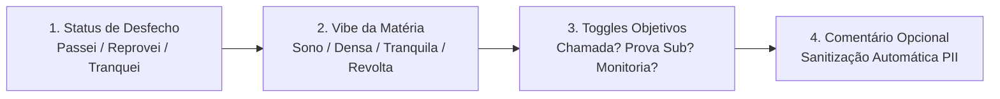

# Portal Web (`services/portal`)

O **`services/portal`** é a aplicação frontend principal do **UnBook 2.0**, mantida pela **Squad Portal (`@unbook-org/squad-portal`)**. Ele entrega uma experiência visual rápida, intuitiva e focada nas necessidades do estudante universitário da UnB.

---

## Visão Geral & Responsabilidades

Construído com base na arquitetura **Mobile-First** e adaptável para **PWA (Progressive Web App)**, o portal oferece:

1. **Hero Search Central:** Barra de pesquisa unificada com busca instantânea em menos de 15ms integrada diretamente ao `services/search`.
2. **Guia Curricular Interativo:** Visualização de ementas, árvores de pré-requisitos/co-requisitos e histórico de turmas da UnB (`services/catalog`).
3. **Simulador de Grade Semestral:** Interface arrastar-e-soltar ou clique rápido para montagem de grades semanais sem choques de horário (`services/planner`).
4. **Wizard de Avaliação Express:** Formulário dinâmico em etapas simples para registro anônimo de avaliações de disciplinas e docentes.
5. **Painel do Estudante (`/catalog/mylist`):** Espaço para o aluno salvar matérias de interesse, acompanhar requisitos concluídos e monitorar créditos acumulados.

---

## Stack Tecnológica

| Camada | Tecnologia | Justificativa |
| :--- | :--- | :--- |
| **Framework** | **Next.js (React 19)** | Server-Side Rendering (SSR) e geração estática para SEO em páginas de disciplinas e cursos; Client-Side Rendering (CSR) ágil no montador de grade. |
| **Estilização** | **Tailwind CSS** | Design responsivo, temas claro/escuro nativos e paleta harmonizada com a identidade visual da UnB. |
| **Estado Global** | **Zustand** | Gerenciamento de estado leve e de alta performance para a grade ativa do Planner e lista personalizada de matérias. |
| **Data Fetching** | **TanStack Query (React Query)** | Cache inteligente de requisições, invalidação automática e revalidação em segundo plano. |
| **Componentes Base** | **Radix UI** | Primitivos acessíveis de interface com suporte rigoroso às normas de acessibilidade (WAI-ARIA). |

---

## Interface & Experiência do Usuário (UX)

### 1. Wizard de Avaliação Express
O portal substitui questionários longos e cansativos por um fluxo de avaliação simplificado em 4 passos objetivos:



### 2. Badges Dinâmicos da "Análise UnBook"
No cabeçalho de cada matéria e professor, o portal renderiza badges gerados por IA e consolidados pelo backend:

- `[PADGE: SONO]` — Indicador de aulas com ritmo excessivamente teórico ou monótono;
- `[PADGE: NÃO TANKEI]` — Indicador de disciplinas com alto índice histórico de reprovação e cobrança rigorosa;
- `[PADGE: JUSTO]` — Alinhamento comprovado entre o conteúdo lecionado em aula e as avaliações aplicadas.

---

## Suporte a PWA & Mobile-First

O portal é totalmente otimizado para celulares e tablets:
- **Instalação na Tela Inicial:** Pode ser instalado como aplicativo nativo via manifest PWA.
- **Funcionamento Offline Parcial:** Consulta a ementas e horários salvos na grade mesmo sem conexão com a internet através do cache local (Service Workers e LocalStorage via Zustand).
- **Gestos Touch:** Navegação fluida por abas de dias da semana na visualização mobile da grade horária do Planner.

---

## Estado Atual: Expo + Integração com o Catálogo

!!! info "Stack real"
    O frontend atual fica em `frontend/` e usa **Expo (React Native) + TypeScript**, rodando na web via `react-native-web`. As seções acima descrevem a visão planejada (Next.js).

### Integração com a API

| Arquivo | Responsabilidade |
| :--- | :--- |
| `src/services/api.ts` | Funções `buscarMaterias()`, `listarDepartamentos()`, `getMateria()`, `getProfessor(identifier)` e `listarProfessores()`. A base vem de `EXPO_PUBLIC_API_URL` (padrão `http://localhost:8080/api`) e os erros do backend chegam como `ApiError` com a mensagem original. |
| `src/hooks/useConsulta.ts` | Hook único de carregamento/erro, com cancelamento da requisição anterior e atraso opcional (debounce). |
| `src/types/materia.ts` | Tipos TypeScript iguais às respostas da API de disciplinas. |
| `src/types/professor.ts` | Tipos TypeScript do perfil do docente, métricas didáticas, turmas associadas e avaliações. |
| `src/screens/home/sections/SearchSection.tsx` | Busca de matérias na home: termo (a partir de 3 caracteres, com 350 ms de debounce), filtro por departamento e paginação. |
| `src/components/SeletorDepartamento.tsx` | Seletor de departamento reutilizável, com filtro por texto que ignora acentos. |
| `src/screens/materia/MateriaScreen.tsx` | Página da matéria (layout do Figma): carrega a matéria por código + nível e trata carregando, erro e 404. Permite navegar para a página de professores associados. |
| `src/screens/materia/sections/` | Seções da matéria: `CabecalhoMateria` (código, nome, departamento, nível, créditos e horas), `EmentaSection` (ementa e panorama), `RequisitosSection` (árvore E/OU clicável) e `TurmasSection` (filtro por professor/turma e semestre). |
| `src/screens/professor/ProfessorScreen.tsx` | Página de perfil do professor (layout neobrutalista do Figma): cabeçalho com foto e contatos, métricas, turmas lecionadas e avaliações com dados da API e mock de demonstração. |
| `src/screens/professor/sections/` | Seções do docente: `CabecalhoProfessor`, `MetricasResumoSection` (com wizard de avaliação interativo em 7 etapas), `TurmasDocenteSection`, `ComentariosSection` e `SidebarCardsSection`. |
| `src/utils/horario.ts` | Converte o horário do SIGAA (`35M34` → "Terça e Quinta, 10h - 12h") e calcula o semestre atual. |
| `src/utils/nivelEnsino.ts` | Níveis de ensino aceitos no `?nivel=` e conversão do nível vindo da API. |

### Página da matéria

- **Nível de ensino:** o código só é único dentro do nível (ex.: `FCE0001` existe em Graduação e em Formação Complementar). A página envia `GET /api/catalog/materia/{codigo}?nivel=<nivel>`, com `graduacao` como padrão. Os outros valores são `formacao-complementar`, `lato-sensu-especializacao`, `lato-sensu-residencia` e `stricto-sensu`. Os requisitos abrem no mesmo nível da matéria exibida.
- **Turmas:** a página lê o campo opcional `turmas` da resposta (`id`, `codigo_turma`, `semestre`, `horario_bruto`, `local_sala`, `vagas_ofertadas`, `vagas_ocupadas`, `professor`). Sem esse campo, mostra "Ainda não há turmas cadastradas".
- **Panorama e dificuldade** mostram "—" e "N/A" até o módulo de avaliações expor dados.

### Página do professor

- **Identificador e Endpoints:** Consome `GET /api/catalog/professores/{identifier}` (aceita UUID, slug como `charles-xavier` ou SIAPE). Na web, pode ser aberta por query param (`?prof=charles-xavier`), pelo botão `[👨‍🏫 Professor]` na barra flutuante de desenvolvimento ou clicando no nome do professor na lista de turmas da matéria.
- **Resumo Didático e Badges:** Exibe notas médias de didática/dificuldade, percentual de frequência de presença, taxa de avaliação justa, badges acadêmicos oficiais e selos de análise UnBook.
- **Wizard Interativo de Avaliação:** Modal em 7 etapas com interface neobrutalista, botões coloridos de resposta com zoom tátil sem símbolos confusos, perguntas sobre chamada obrigatória e monitoria ativa em sala, notas por estrelas e relato anônimo.
- **Turmas do Semestre e Matérias:** Lista as disciplinas e turmas ativas ministradas pelo professor com suporte a navegação direta para a tela da respectiva matéria.

A troca entre home, matéria e professor é feita por estado em `App.tsx`, com suporte a links diretos via query params (`?materia=...` e `?prof=...`) e barra flutuante de desenvolvimento.

Para testar no celular, `localhost` não funciona: defina `EXPO_PUBLIC_API_URL` com o IP do computador (ver `frontend/.env.example`).

---

## Execução Local

```bash
# Navegue até o diretório do serviço
cd services/portal

# Instale as dependências
npm install # ou pnpm install

# Configure as variáveis de ambiente
cp .env.example .env.local

# Inicie o servidor de desenvolvimento
npm run dev
# Disponível em http://localhost:3000
```
